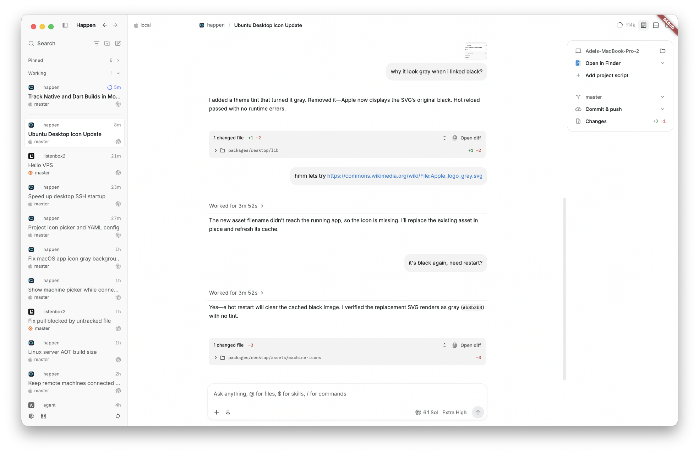

# Happen

Our own AI coding agent harness, built in Dart with a Flutter desktop app.



Work across projects and conversations, inspect the context sent to the model,
run tools and terminals, and steer or interrupt an agent while it works.

## Why

We're building our own harness because we're tired of sloppy behavior in Codex
and OpenCode. Electron, Rust, JavaScript, and all the plumbing between them:
it's all so tiresome. We want a stack we can understand, inspect, and change
while the app is running.

Dart gives us one language for the desktop UI, server, and harness, with native
ahead-of-time compilation for releases and stateful hot reload during development.
The rationale is laid out in
[A self-modifying AI agent, part one: choosing a language](https://adelnz.com/writing/a-self-modifying-ai-agent-part-one-choosing-a-language/)
and [A critique of Codex](https://adelnz.com/writing/a-critique-of-codex/).

The Dart team's
[An update on Dart macros & data serialization](https://dart.dev/blog/an-update-on-dart-macros-data-serialization)
puts the language choice well:

> We believe that Dart offers a unique combination of strengths: (1) the ahead-of-time compilation and performance typical of static languages, and (2) the fast development cycle (e.g., stateful hot reload) typical of dynamic languages. As we’ve evolved Dart, we’ve been careful to evaluate language changes against both of these rubrics.

I believe this is the way.

## Design decisions

- **In-process JavaScript through QuickJS.** The
  [code mode runtime](packages/code_mode/) embeds QuickJS through Dart FFI.
  JavaScript cells call the harness's tools directly through the host bridge.
- **In-process server on desktop.** The [server](packages/server/) runs inside
  the [desktop app](packages/desktop/). Dart isolates handle work within the
  same process. The UI connects over private Unix-domain WebSockets on
  macOS/Linux and authenticated loopback on Windows.
- **100% interruption, down to tool calls.** Stop propagates cancellation
  through model streaming, JavaScript cells, and nested tool calls. A native
  QuickJS interrupt reaches running JavaScript even while its Dart isolate
  is inside FFI.
- **MCP Events draft support.** [Our MCP client](packages/mcp/) implements
  [experimental-ext-triggers-events](https://github.com/modelcontextprotocol/experimental-ext-triggers-events),
  including push, polling, and signed webhooks. Server-owned subscriptions can
  wake unloaded conversations without a connected desktop client. This is an
  experimental protocol, not part of the released MCP core specification.
- **100% harness parity with Codex at the model boundary.** The
  [Codex context contract](test/contracts/codex_context_test.dart) runs the
  same scenarios through both harnesses and compares the actual outgoing
  model requests. It checks instructions, context, tools, results, and
  continuation behavior. Run-specific IDs, timings, and client telemetry
  are normalized; the remaining fields and array order are compared strictly.
  Pass/fail is based on functional contracts, not speed.

## Run the desktop app

From the repository root, with Moon and Flutter's desktop build prerequisites
installed:

```sh
git submodule update --init --recursive
third_party/flutter/bin/flutter pub get
moon run dev -- --status
moon run dev
```

The launcher reuses an existing Happen instance. Development uses the vendored
Flutter SDK and supports hot reload.

For a macOS release build:

```sh
moon run release
```

The app is written to
`packages/desktop/build/macos/Build/Products/Release/Happen.app`.
See the [desktop guide](packages/desktop/README.md) for controls, configuration,
toolchain details, and installation.

## Release RAM usage

I'll add RAM usage from the release app here once I have the measurements.
