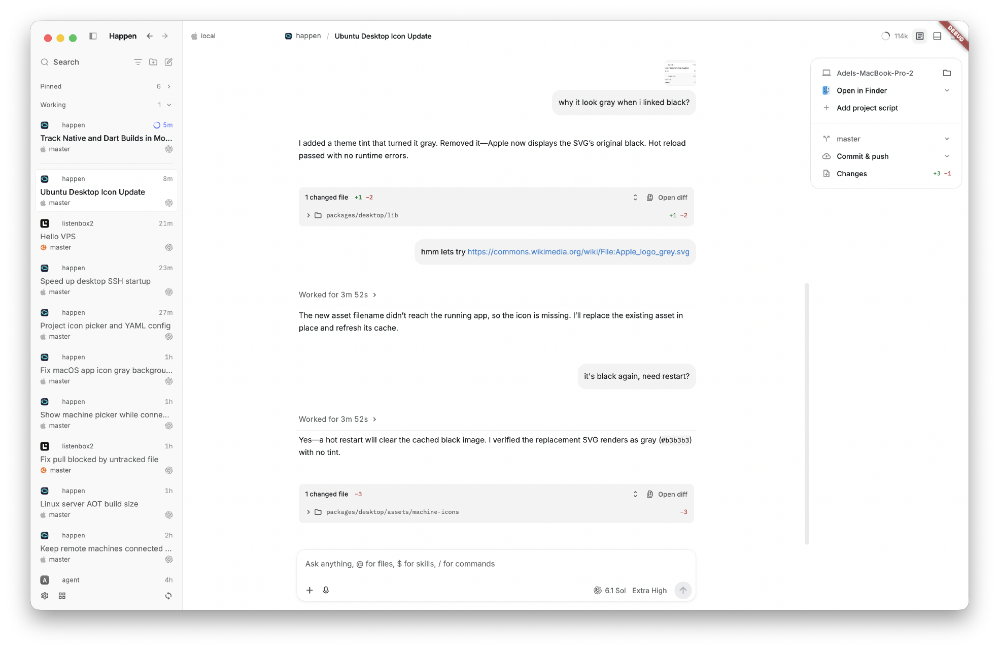

# Happen desktop

Happen's Flutter desktop app, with the agent harness and server in the same
process.



Read [why we're building Happen](../../README.md#why) and the
[design decisions](../../README.md#design-decisions): Dart and Flutter,
in-process QuickJS and server, interruption down to tool calls, and Codex
harness parity.

Release app RAM measurements will be added to the
[project README](../../README.md#release-ram-usage) once available.

## Using Happen

**Settings → Appearance → Project icons** switches between **Letters** (the
default) and **Generated**, matching OpenCode's `projectAvatar.style` experiment.
**Settings → Projects** lists added folders and opens each project's settings.
Rename a project, upload or drop a custom icon, or choose one of OpenCode's nine
colors. Names and icons also update throughout the app and are saved per project.
Use the project menu to open it, copy its folder path, or remove it from Happen.
Larger lists can be searched by name or path.

Uncolored letters are gray;
choosing a color keeps the uppercase letter even in Generated mode. Click the
selected color again to return to the default. Choices are saved per project.

The conversation uses OpenCode's message model and presentation, with Inter and
IBM Plex Mono fonts, compact spacing, and its working indicator. Nested tool calls
appear inline; **View code** opens the JavaScript source.
Hover a finished OpenCode response to copy it or see its model, reasoning level,
and turn duration, rounded to seconds (or minutes and seconds for longer turns).

Hover a finished response and choose **Fork from this response** to open a new
conversation containing history through that turn. The new chat is named with a
“fork” suffix; the original conversation and its unsent draft are preserved.

Select response text and choose **Add to chat** to attach an annotation. Add an
optional comment with the keyboard or microphone; stopping dictation inserts
the words into that comment, and **Save** attaches it to the draft. **Escape**
closes the editor and releases its microphone while retaining the comment.
Edit or remove annotations above the composer. They survive navigation and
failed sends; the next accepted message includes their selections, comments,
and source ranges. Inline **Annotation N** references preview the submitted
context and comment.

Questions appear above the composer. Choose an option, select several when
allowed, or type your own answer. **Back** and **Next** move between questions;
draft answers survive switching tabs. On macOS, use the microphone to dictate an
answer; **Enter** finishes dictation before advancing or submitting. Use number keys to choose, **⌘Enter**
(**Ctrl+Enter**) to advance or submit, and **Escape** to dismiss.
OpenCode and GPT sessions support questions. GPT can also ask while continuing
work; submitting that answer sends a user message into the current turn.

**Settings → Interface** offers **Top tabs**, **Side
tabs**, and **Inbox**, using OpenCode's layout previews. Top and side tabs can
be dragged to reorder or closed without archiving their sessions. **Home** and
**Search sessions** reopen them. Inbox groups recent results and sessions that
need attention, with collapsible **Archived** and **Working** sections. The
**Working** section stays below the scrolling list. Tab order, layout, read
markers, and sidebar choices are saved.

Press **⌘K** (**Ctrl+K** on Windows/Linux), or click **Search sessions**, to
search commands and active sessions. Use **↑/↓** and **Enter** to open a result,
or **Escape** to close the menu. **Archived sessions** opens Settings directly
to the archive page; archived chats stay out of command-menu search results.
The archive list uses the full available height. Select a chat to preview its
conversation inside Settings, then go back to the archive or restore it.

Saved sessions come from the server's durable session list, not the live-agent
registry or a desktop-only sidebar entry. Its shared SQLite catalog survives a
crash; interrupted work is not restarted. Fresh installations start with an empty
catalog. Home and project selection also refresh the list. Closing a tab does not
remove a saved session.
Inbox keeps interrupted sessions under **Needs attention** even though their
agents are no longer running; opening their history does not resume execution.
Open transcripts watch live messages and activity, including turns awakened by
MCP events after reconnecting. These view subscriptions let idle agent runtimes
unload and do not start inference.
Saved MCP watches resume automatically when Happen relaunches, including watches
on threads whose tabs are closed. The server queries its SQLite recovery index
and reconnects unarchived threads using their saved subscriptions and cursors.
Incoming events use a compact notification card with the source, declared event
name, and timestamp. **Event details** expands the original payload for inspection
and copying. The same card handles every provider and event schema; queued events
keep their Send/Steer and Delete actions.

Double-click a thread title in the sidebar or Home, press **F2** on its focused row,
or choose **Rename thread** from its right-click menu to edit the title inline.
The input immediately receives focus and selects the current title. **Enter**
saves it; **Escape** or moving focus away cancels. Empty titles are rejected.

Right-click an Inbox session to archive or restore it, or use its hover action.
Hover a session to pin or unpin it with the pin button, or choose **Pin session**
or **Unpin session** from its right-click menu. Pins are saved across launches.
The sidebar keeps pinned thread cards above **Working**. Drag a pinned card to
reorder it; **Escape** cancels the drag. The order is saved across launches and
also used by Home and top/side tabs. Filtering by project reorders that project's
pins in their existing positions. Click the **Pinned** or **Working** heading to
collapse or expand its chats, including the selected chat. Both sections remember
their expansion across launches; keyboard navigation skips collapsed chats.
Reordering uses a Dart state machine for pickup, drop animation, pending save,
commit, failure, and cancellation. Failed saves restore the previous order;
cancelled drags never change it.
Closing a tab keeps its session pinned. Archived sessions leave the pinned list
until restored.

Session status uses a blue animated **Working** indicator, a neutral idle ring
with its age, and distinct **Done**, **Failed**, and **Interrupted** cues.
Chats awaiting an answer show a purple **Input** indicator instead of Working,
including questions from side chats. Input remains visible until answered or
dismissed, even for questions that let the agent continue working.
Pins remain neutral and visible alongside activity; the selected session uses
a neutral background. These cues are shared by Inbox, tabs, and Home.

**Settings → Preferences** includes **Chat notifications** (Off, notifications
only, sound only, or notifications with sound) and **In-app notifications**.
Both default to off. Live questions, completed chats, and failures trigger
alerts; stopped runs and restored history stay quiet. Foreground alerts for
other chats include **Open chat**; system alerts appear while Happen is in the
background and open their chat when clicked. macOS shows the unread alert count
on the Dock icon and clears it when Happen regains focus. Notifications and sounds
live with the desktop process: closing the macOS window keeps them active until
Quit. Notification clicks reopen the window and select their chat. Notification sounds
come from T3 Code; their MIT license is bundled beside the audio assets.
Adding the native notification plugins requires a rebuild and relaunch.

Archiving works even when the conversation history cannot load; saved history is
kept. **Settings → Archived tasks** also lets you restore an archived session.
Archiving the selected session switches to the next open session to its right,
or the previous one to its left, skipping draft tabs. If no session tabs remain,
Home opens. Archiving another session or restoring one keeps the current view.
The sidebar updates immediately while the archive is saved and resources close.
A failed archive restores the row and tab without losing its draft or history.
Archive and restore do not show a success toast.

The macOS window uses its full content area. The native traffic lights sit in
the sidebar header in Side tabs and Inbox, or beside the top tabs. Drag empty
header space to move the window; double-click follows the macOS title bar setting.
Click the sidebar icon or press **⌘⇧B** to collapse or reopen the sidebar. While
collapsed, hover the window's left edge or rest on the icon to preview it over
the conversation. On Windows/Linux, use **Ctrl+Shift+B**.

Live responses reveal incoming text on display frames, updating only the
streaming message. OpenAI requests visible reasoning summaries by default;
Thinking shows their current heading, and Thought expands the saved summary.
The latest activity owns the live status: running tools show their operation,
then yield to Thinking when they finish. A separate Thinking row appears only
when no activity, final answer, image generation, compaction, or blocking question
already owns that feedback.
Skill reads remain named inside JavaScript cells and in collapsed activity.
Activity groups start collapsed. JavaScript call rows remember their own open
state as new calls arrive and when the cell is reopened.

File-change activity expands to a compact folder tree with added and removed
line counts. Finished responses show the net changes for that turn below the
answer. Click a file or **Open diff** to review all changed files in the side
panel. The viewer follows Harness's continuous review: **Auto**, **Unified**,
and **Split** views, word wrap, syntax colors, word-change highlights, individual
and global folding, and per-file copy and open actions. Wide panels include a
searchable file list; **Jump to file** is available at every width. **Changes
options** toggles whitespace filtering and word highlights. Saved conversations
retain their turn diffs.

The top-right toolbar toggles project details, the terminal, and the side panel.
Project details sits beside the conversation in wide windows and opens as a
floating card in smaller windows. It shows the host and project folder,
**Open in Finder** (or an installed editor), saved project scripts, the branch,
Git actions, and **Changes** with added and removed line counts.
Scripts can be added, edited, and deleted; running one opens its own terminal
tab in the project folder. The preferred application and scripts survive relaunch.
The branch picker switches local branches, tracks remote branches, and creates
new branches. **Changes** opens the checkout review. Choose **Uncommitted** for
staged, working, and untracked changes compared with HEAD, **Staged** for the
index compared with HEAD, or **Unstaged** for the working tree compared with the
index, including untracked files. **Refresh changes** retains the last successful
patches and viewport while reading their replacements. Patches load as needed;
binary files, renames, metadata-only changes, and preview limits have explicit
messages. Hidden checkout panels cancel pending reads.

The details card's Git control offers **Commit**, **Push**, and **Commit & push**.
The commit dialog shows the branch and lets you select files and enter an
optional message. Leave the message empty to generate it with the selected
model. Generation runs on the server without adding a conversation turn.
Actions show progress, can be cancelled, and retain a successful local commit
if its push fails. Excluded staged files remain outside the commit.
Commit and push use sealed Dart states on both desktop and server. Pending
writes, cancellation, successful commits, push failures, and the final status
refresh are explicit; a push retry uses the existing commit.

Composer and user images use OpenCode's cropped 58×46 thumbnails. User images
sit above the message bubble; composer attachments scroll horizontally and show
their remove button on hover. Assistant Markdown and tool images keep their
aspect ratio without thumbnail cards or captions. Clicking an image opens the
window preview with zoom, pan, fit, and close controls. Left and Right switch
between images from the same message, stopping at either end and resetting zoom.
The preview also has previous/next buttons and an image count. Escape fits a
zoomed image first, then closes it.

Generated images use inline galleries, including when completed work is folded.
Saved originals take precedence over inline base64, adjacent images share a
thumbnail selector, and their preview navigates all generated images in the
conversation. Active generation shows a dot animation that respects reduced
motion and stops when interrupted. Consecutive image inspections share a
collapsed “Viewed N images” disclosure with preview thumbnails.
Inspection previews read the recorded image through the owning server, so a
temporary source file can be removed without breaking its thumbnail or viewer.

Drag the sidebar's right edge to resize it. The chosen width is saved between
launches and adjusts to keep room for the conversation in a smaller window.
The edge has OpenCode's delayed pill on hover and a darker pill while dragging.

**⌘J** opens and focuses the integrated terminal in the current project's folder.
Repeated presses focus the same shell. The panel retains shells separately for
each chat or draft tab; hiding it or switching chats keeps them running.
Use **+** for another shell, **×** to stop one, and the down arrow to hide the
panel. Drag its top edge to resize it. Archiving immediately stops all of that
chat's terminals, including hidden tabs and background jobs; restoring the chat
starts fresh shells.
A draft's terminals follow its first submitted task. Hibernating the agent leaves
the terminal alone. Removing a project or quitting closes its shells and drains
native resources. On Windows/Linux, use **Ctrl+J**.

**Option+Up/Down** moves between sessions in the current navigation view.
Conversation drafts are retained while navigating.

**New session** opens a draft tab. The project control below its composer opens
a searchable menu with project avatars and **Add project**. Changing projects
keeps that tab's prompt, attachments, model and reasoning. Each draft tab saves
its project, prompt, cursor, file references and model choices across relaunches;
sending replaces that tab with the created session.

Use a project's **… → Remove project** menu to remove it and its task entries
from Happen. Confirming stops running tasks and clears drafts; the project folder
and saved task history are kept. Missing folders are greyed out when Happen
launches, with new tasks and messages disabled while existing conversations remain
readable. Availability is checked at launch, without polling or a refresh button.
Open a restored folder again to make its existing project available.

The header's context ring opens **Context** in OpenCode's full-height right panel,
beside the conversation and composer. **⌘B** (or **Ctrl+B**) toggles the panel;
drag the divider to resize it. The tab strip supports closing, adding, and
reopening tabs, and **⌘W** closes the focused panel tab. Open tabs, selection,
visibility, and the divider width are saved per session. Hiding the panel keeps
its content and scroll position; closing its last tab hides it.

On macOS, choose **Browser** from the panel's new-tab page, **Open browser**
from the command menu, or type `/browser`. Browser tabs have an address/search
bar, Back, Forward, Reload/Stop, Copy link, and Open in system browser.
Bare localhost and loopback addresses use HTTP. **⌘L** selects the address,
**⌘R** reloads, **⌘T** opens a browser tab, and **⌘W** closes the focused panel
tab. Open browser tabs and their last addresses are saved per session.
Conversation web links open inside Happen; authentication still uses the system
browser.

Use **Annotate page** in the browser toolbar to pick an element or drag an area.
Hold **Shift** to collect several targets in one comment, **Space** to browse
temporarily, or **Escape** to leave annotation mode. Selecting ordinary page text
also offers **Add to chat**. Browser comments use the same editor and dictation
controls, and include the page URL, selector, nearby text, and selection geometry
in the next message. They do not capture screenshots.

Local **HTML** and **PDF** links open in the file panel using the same macOS
WebView. HTML starts in Preview, with a Source toggle and line navigation.
HTML resources can load from the session's project folder. PDFs use WebKit's
native viewer. Reload rereads the file; previews work offline. Source views
retain the 2 MB text limit.

**Context** shows the actual saved system prompt,
provider/model, context limit, token and cache counts, tools, model settings, and
expandable inference input in model order. The compact stats, sticky
message headers, and wrapped JSON follow OpenCode's context panel. System Prompt,
Tools, Model settings, Raw messages, and individual messages remain collapsible.
OpenAI input uses Responses API JSON, including the first developer message
labeled **System Prompt**, native reasoning, tool calls and results. Tools and
model settings use the same request serializer as inference. Injected context
keeps the role actually sent; the inspector does not invent synthetic API fields.
All context pages load from one immutable snapshot. **Export session** saves
only the displayed inference request to Downloads with a unique title-based
filename, including `input`, `tools` and request settings. Internal records and
transcript projections are not included.
Usage becomes available after a response measures the current context, including
after compaction.
The composer groups the model/reasoning menu, microphone, and Send/Stop.
The model/reasoning menu keeps models fixed for existing tasks; supported reasoning
changes apply to the next message.
Switching models keeps the draft's reasoning preference. Models that do not support
it use their default until you switch to a model that supports it again.
One action button sends messages, or stops a running task when the draft is empty.
With a draft or attachments during a running task, it steers or queues the message
according to Settings.

Pending steering messages offer **Move to queue** and **Delete** beside Copy.
Queued messages offer **Steer** while the session works, or **Send** while idle,
plus **Delete**. These controls also appear on messages containing only attachments.
Delete withdraws that input without stopping the active response. Delivery changes
keep the prompt, attachments, timestamp, and queue position; controls disable while
the request is in flight. A message that has already started cannot be withdrawn.

Servers requiring MCP authentication appear inline in the conversation above the
composer. Choose **Sign in** to open the default browser; waiting, retry and
cancellation stay in the conversation. Successful connection removes the request
and makes tools available on the next model step without changing the draft.

Type `/mcp` and press Enter to view MCP server status in the composer popover.
The list includes global servers and the current project's `.happen/config.yaml`
overrides, matching the servers available to its agent.
Use `/mcp verbose` for tool names, resources, and resource templates. Both use
the same popover as `@` file search. HTTP OAuth servers offer **Sign in**, which
opens your default browser, and **Sign out** after connection. Cancel stops a
pending login; Open browser retries launching the browser. Type to filter,
press Escape to close, or start a new `@` mention to switch back to files.
Commands preserve surrounding draft text and run without sending a message.

On macOS and Windows, closing the window keeps Happen and its embedded server
running. The tray menu has **Show** and **Quit**. Show restores and focuses the
window; Quit shuts down the server and exits the process. The macOS Dock also
reopens the hidden window.

With the window focused, press **⌘Q** on macOS or **Ctrl+Q** on Windows to show
a dark translucent quit hint, then press it again within one second to quit.
The hint fades out over 200 ms. Holding the key does not confirm. Escape, another
key, clicking, or switching away cancels the confirmation. Clicks continue to
the window underneath. The tray's Quit action quits directly.

The server stays in the desktop process on every platform. macOS/Linux use
private UDS WebSockets; Windows uses an ephemeral authenticated loopback port.
Native tray changes require a rebuild and relaunch.

Session events and message parts use the OpenCode schema shared by the server,
SQLite projection, and Flutter renderer. Every session keeps one `history.sqlite`
file with a single writer isolate and independent read-only WAL snapshots.
The durable inbox is in that same database. Existing histories are projected by
their session writer when first opened; live notifications use the same events
as replay. WebSocket RPC, event acknowledgements, and backpressure remain the
transport. Provider inference and credentials still support ChatGPT and OpenCode.

Paste images with Command+V or Paste in the composer, or drag images and files
onto it. Preview or remove attachments before sending; image-only messages work.
Failed sends keep the draft and attachments. A native rebuild installs the macOS
clipboard bridge and drag-and-drop plugin.

The embedded server reads local image paths and applies Codex's image sizing.
For remote connections, the desktop accepts originals up to 1 GiB and prepares
oversized images off the UI thread to fit the combined 32 MiB encoded image
budget before sending. Smaller originals stay unchanged when they fit. Ordinary
remote files upload in blocks of up to 24 MiB; local files remain path references.
Cancellation preserves the draft. Saved conversations retain prepared image
bytes. Remote server selection remains outside the current desktop UI.

Images returned by tools appear inside the tool result, including JavaScript
cells. Expand the activity to see the images, then click one to inspect and zoom
inside Happen. Saved results contain the same prepared image bytes sent to the
model.
OpenAI uses `image(...)` with MCP image blocks or `tools.view_image(...)`;
OpenCode's `read` and MCP tools present images directly to the model.

The Windows runner and QuickJS build path target x64. In addition to Flutter's
Visual Studio tooling, the Windows QuickJS build uses
[MSYS2 UCRT64 GCC](https://www.msys2.org/docs/environments/), defaulting to
`C:\msys64\ucrt64\bin\gcc.exe`. A different installation can be selected in the
workspace root `pubspec.yaml`:

```yaml
hooks:
  user_defines:
    code_mode:
      mingw_cc: 'D:/msys64/ucrt64/bin/gcc.exe'
```

This compiler is only needed when building on Windows. macOS/Linux keep the
existing native build path.

On macOS, click the composer's microphone to dictate with the local ChatGPT
account. The editor stays editable while the mic shows its recording waveform.
Settings opens a separate screen with a saved Dictation mode: **Live** (the
default) shows text while you speak; **On stop** inserts it after recording.
Live mode falls back to transcription on stop if its connection fails. Each
recording keeps the mode it started with. Stop finishes the transcript; Enter
or Send finishes and sends. Escape or Cancel discards the recording and restores
untouched dictated text. Failed transcription keeps the audio for Retry;
changing chats cancels the old attempt.

Audio is uploaded directly from the desktop to OpenAI. The local backend only
supplies authentication, independently of the task's selected model/provider.
Audio stays in memory and is cleared after completion or cancellation. A native
rebuild is needed to install the microphone bridge and permission description.

Tasks have no elapsed-time or step limit. GPT reconnects interrupted model
streams with bounded retries, and the conversation shows reconnection progress
and terminal failures. Stop or archive a task to end it. The embedded server
runs inside Happen, so quitting the application stops its work.

## Development

From the repository root:

```sh
git submodule update --init --recursive
third_party/flutter/bin/flutter pub get
moon run dev -- --status
moon run dev
```

The guarded launcher reuses any running Happen app, including installed releases,
or a Flutter supervisor for a Happen checkout in any build mode. This also covers
Flutter while it is still building. Concurrent launcher calls share a lock across
checkouts. If several instances already exist, it reports their PIDs and exits
without starting another. Use this launcher for development launches.

`dev` is a persistent, interactive Moon server task. New sessions run Flutter in
the foreground with live output: press `r` to hot reload, `R` to hot restart,
or `q` to quit. Ctrl+C stops the session. The command stays open until Flutter
exits and returns its exit status.
Reusing an existing session waits for it to exit and keeps its original
terminal/VM controls. `moon run dev -- --status` only inspects and exits.
Checkout locks and supervisor metadata stay in the ignored `.local/run/`;
the shared launch lock stays in the system temporary directory. They are never
added to the app bundle.

### Vendored development SDK

`moonx dev` (`moon run dev`) uses the `third_party/flutter` submodule from
[meoyawn/flutter](https://github.com/meoyawn/flutter), branch `happen/stable`.
It contains the fix for [Flutter #195780](https://github.com/flutter/flutter/issues/195780)
([upstream PR #195781](https://github.com/flutter/flutter/pull/195781))
on stable Flutter 3.47.9 / Dart 3.13.7: the mouse update guard is cleared in
`finally` after a hit-test or hover exception. The fix and its five regression
cases live in the fork. SDK source is never patched by a launch script.

Update the fork by incorporating upstream stable and rerunning its mouse tracker
tests, then update the submodule commit. Use the vendored `bin/flutter` for direct
development commands. An already-running supervisor switches SDKs on the next
development launch; an already-frozen process needs a restart to reset its state.

Debug builds use the amber Relay tile and bundle ID `com.adelnz.happen.debug`.
Release and Profile use lime on deep green and `com.adelnz.happen`. The
[icon design and generation guide](design/README.md) covers all three surfaces.
Separate IDs keep macOS from reusing the installed release's Dock icon for
development. Changes
to native icons or bundle IDs require quitting and rerunning `moonx dev`;
Flutter hot reload and hot restart do not update the macOS app bundle.

### Release builds

```sh
moon run release
moon run release-reinstall
```

`release` uses Homebrew's installed Flutter and its bundled Dart SDK, locating
the installation through `brew --prefix`. It requires a clean stable SDK and
records the installed versions without fetching or upgrading Flutter. The
development fork is excluded from the release source snapshot.

The build uses a snapshot of the working sources, including uncommitted changes
and submodules. Its package configuration, Xcode files and native build products
are isolated from the running development app. The signed result is copied to
`build/macos/Build/Products/Release/Happen.app` under this package, with exact
Flutter, Dart and engine versions recorded alongside it in `toolchain.json`.
`release-reinstall` builds first, stages and verifies the bundle, and installs
it at `/Applications/Happen.app`.
It stops the installed release before replacing the bundle and leaves it
stopped. Failed replacement validation restores the previous bundle and leaves
it stopped too. `reinstall-release` is an alias.

The development launcher also reuses a running release instead of starting a
debug app alongside it. Reinstallation preserves the debug app and checks the
release executable's full path immediately before signalling it. For a different
installation directory, use
`moon run release-reinstall -- --applications-dir /path/to/Applications`.
The guard applies to these local launch/install commands; launching the app
directly bypasses it.

The composer uses a virtual line editor with a bounded viewport for large
drafts. Its completion popover follows OpenCode, including file and folder icons
for each language and special filename. Up/Down changes the selected suggestion
without moving the caret; Enter or Tab accepts it, and Escape closes the popover.

Type `@` to find project files and folders, projects, other sessions, MCP resources,
and MCP tools. Quoted queries support paths containing spaces. File references
retain their full path and serialize as Markdown links; they do not upload file
contents. Session references include the text from up to 20 recent messages.
The **+** menu opens context search, commands, prompt history, or attachments.
**Shift+Up** opens searchable prompt history for the current session.

Type `/` for local commands, model choices, reasoning levels, and skills. Model
and reasoning choices follow the same availability rules as their picker.
`/new`, `/context`, `/terminal`, `/history`, and `/attach` open their respective
actions; `/mcp` and `/mcp verbose` show server status and inventory.

Type `$` to search skills, or find them alongside files with `@` and commands
with `/`. Skills come from the server's project and user `.agents/skills/`
directories. Suggestions show the name, description, and Project or Global
scope. Select one with Up/Down and Enter or Tab, or click it, to insert an inline
skill reference. Escape dismisses suggestions. Selection preserves the full
`SKILL.md` path through editing, undo, copying, and draft navigation; sending
serializes it as `[$name](/path/to/SKILL.md)`. References appear as blue labels in
the editor, with a skill glyph in suggestions. Discovery returns metadata only; the agent
loads the skill instructions when needed.

Mention search waits for a 120 ms typing pause, caches up to 20 recent queries for ten
seconds, and cancels superseded requests. Late replies cannot change a newer
draft or another task's composer. File search shares the task WebSocket and
remains available while other tasks are streaming.

The macOS build normalizes bundled native asset paths to their framework install
names. This works around [Flutter #190799](https://github.com/flutter/flutter/issues/190799),
which can load SQLite twice when rebuilding while the app is running. The step
is harmless on SDKs that already contain the upstream fix. Stop and relaunch
Happen once after applying this change; hot reload cannot repair existing mappings.

Verify the built SQLite framework across file replacement without changing the
application or its data:

```sh
flutter build macos --debug --no-pub
dart --disable-dart-dev tool/verify_native_assets.dart
```
