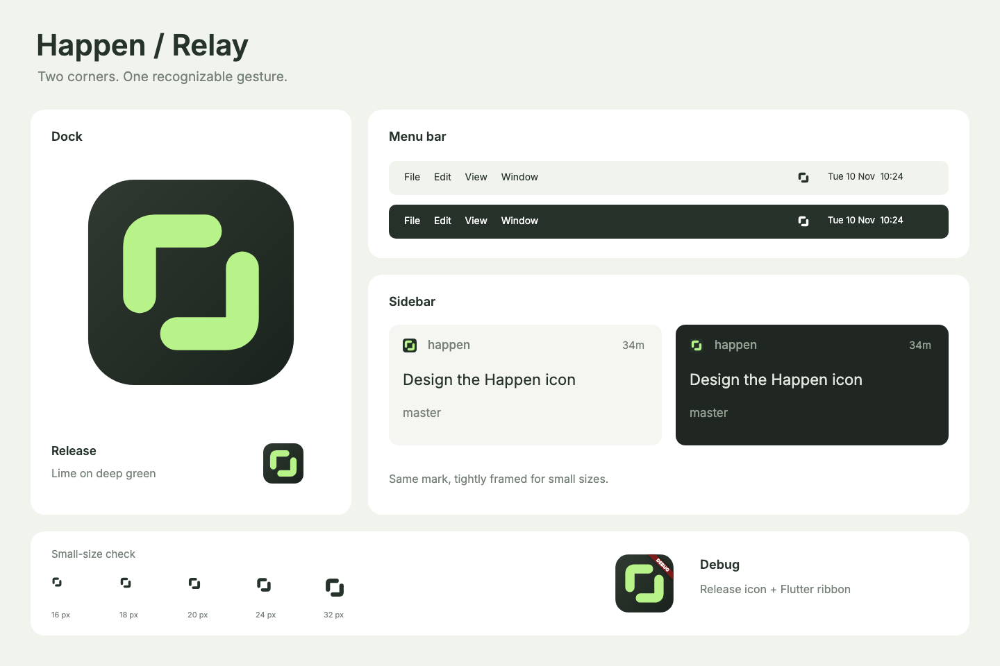

# Happen / Relay

Two opposing rounded corners form an open loop. The diagonal gaps stay open at
small sizes, so the silhouette works without color, shading, or a letterform.



The geometry lives in [`happen-mark.svg`](../assets/app-icons/happen-mark.svg).
Change that source and regenerate; do not draw separate versions of the mark.

| Surface | Treatment | Output |
| --- | --- | --- |
| macOS release / Profile | Lime `#B8F38A` on deep green `#303A31` → `#19221C` | `AppIcon.appiconset`, 16–1024 px |
| macOS Debug | Release icon with Flutter's red `DEBUG` corner ribbon | `AppIconDebug.appiconset`, 16–1024 px |
| macOS menu bar | Transparent monochrome template, 18 pt at 1×/2× | `HappenStatus.imageset` |
| Project sidebar | Lime on a flat `#233027` tile; expanded mark, no Dock padding | `happen-sidebar.svg` |

Debug uses the same lime mark and dark background as release, with Flutter's
`BannerPainter` adding a red `DEBUG` ribbon in the top-right corner. The ribbon
and its lettering are scaled 50% larger for readability at Dock sizes.
The ribbon is clipped to the tile's rounded silhouette. Menu bar appearance is supplied by macOS through
[`NSImage.isTemplate`](https://developer.apple.com/documentation/appkit/nsimage/istemplate).

The Dock tile occupies an exact 824 × 824 rectangle at (100, 100) on the 1024 px
canvas, with a 185 px corner radius. Its clean alpha mask avoids the extra
background that macOS can add to irregular artwork. The base tile has no baked
shadow, bevel, or rim; macOS applies its native finishing. Every size renders from
the vector source, with supersampling for the smallest rasters.

Regenerate from the repository root using a Flutter SDK with desktop artifacts:

```sh
dart packages/desktop/tool/generate_app_icons.dart
```

An optional positional argument selects the Flutter SDK. The generator uses the
offscreen Flutter engine, writes both native icon sets, menu bar assets, the
sidebar SVG, and this preview. It never launches the desktop application.

Validate both native sets with `xcrun actool` and inspect a temporary compiled
bundle through `NSWorkspace.iconForFile`. Checking only the source PNG misses
macOS's final masking and material treatment. Check menu bar templates on light
and dark backgrounds, including their 18 px raster, and the sidebar at 16–24 px.

The project config points directly to the sidebar SVG. Native Dock and menu bar
changes require a rebuild and relaunch; hot reload cannot replace the bundle's
asset catalog.
